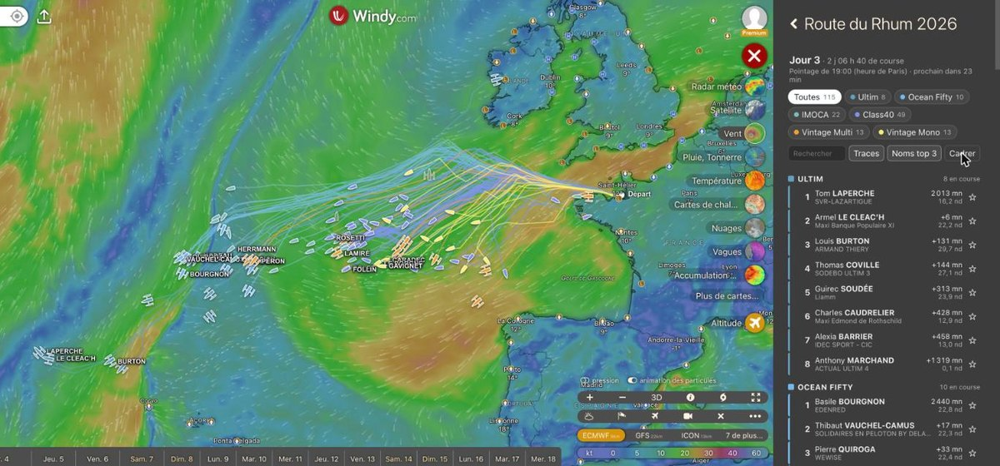

# ⛵ Route du Rhum 2026 en direct, plugin Windy

Les 115 bateaux de la Route du Rhum Destination Guadeloupe 2026 affichés sur la carte Windy, par dessus le vent, les vagues ou n'importe quelle couche météo.



## Ce que fait le plugin

1. Position de chaque bateau au dernier pointage officiel, dessiné vu du dessus selon son type (trimaran, catamaran, IMOCA à foils ou à dérives, Class40 à étrave ronde, monocoque classique) et aux couleurs de son équipe, reprises de la cartographie officielle. Icône orientée au cap, sillage proportionnel à la vitesse, trace à la couleur du bateau, taille adaptée au zoom, noms sans chevauchement.
2. Trajectoires de toute la flotte depuis le départ.
3. Classement par classe : rang, gain ou perte de places, distance à l'arrivée, écart au leader, vitesse.
4. Clic sur un bateau : fiche avec photo, vitesse moyenne 24 h, cap, VMG, position, vent du modèle Windy à l'endroit du bateau, bouton « Météo ici » qui ouvre le picker Windy.
5. Filtres par classe, recherche par skipper, bateau ou numéro de voile, favoris ★ (gardés dans le navigateur), noms sur la carte (top 3 par classe, tous, aucun).
6. Actualisation automatique juste après chaque pointage horaire.
7. Lien direct vers un bateau : `https://www.windy.com/plugin/route-du-rhum-flotte/horeau` (nom du skipper, numéro de voile ou identifiant course).

## D'où viennent les données

| Donnée | Source | Rafraîchissement |
| --- | --- | --- |
| Classement et positions | Flux public du site officiel `routedurhum.com/_functions/classement`, lu directement par le plugin | Chaque pointage (toutes les heures) |
| Trajectoires du départ au 3 novembre 15 h UTC | Cartographie officielle (Géovoile), échantillonnée toutes les 3 h, figée dans `scripts/seed-geovoile.txt` | Une fois |
| Trajectoires ensuite | `data/tracks.json`, alimenté par le workflow `update-tracks` | À chaque pointage, quelques minutes après sa publication |

Si le site officiel ne répond pas, le plugin affiche le dernier relevé enregistré dans `data/latest.json`. Si GitHub ne répond pas, il utilise les trajectoires embarquées dans le plugin.

Les livrées des bateaux sont dans `data/boats.json`, généré par `node scripts/build-boats.mjs` à partir du relevé `scripts/geovoile-colors.txt` (type de silhouette, couleurs de coque, pont, cockpit, foils ou bras, couleur de trace, par identifiant course). Le plugin relit ce fichier à chaque ouverture puis toutes les 30 minutes : une correction de couleur ne demande pas de republier. Un bateau absent du fichier garde la couleur de sa classe.

## Mise en ligne (une seule fois, 3 minutes)

1. **Créer le dépôt** public `windy-plugin-route-du-rhum` sur GitHub (vide, sans README). Il doit être public : le plugin y lit les trajectoires.
2. **Clé Windy** : sur <https://api.windy.com/keys>, créer une clé de type **Windy Plugins API**.
3. **Secret GitHub** : dans le dépôt, Settings, Secrets and variables, Actions, New repository secret. Nom `WINDY_API_KEY`, valeur la clé de l'étape 2.
4. **Pousser ce dossier** sur la branche `main`. Deux workflows démarrent seuls :
   **publish-plugin** publie le plugin et écrit son lien dans `PLUGIN_URL.txt` (et dans le résumé du job),
   **update-tracks** enregistre chaque pointage dès sa publication. Il tourne en relais (chaque exécution réserve la suivante) jusqu'à l'arrivée du dernier bateau, le cron ne servant que de filet de sécurité.

Si le secret est ajouté après le premier envoi, lancer **publish-plugin** à la main (Actions, publish-plugin, Run workflow).
Le lien publié a la forme `https://windy-plugins.com/<id>/windy-plugin-route-du-rhum-flotte/1.0.0/plugin.min.js`.

## Installer et partager

Il faut un compte Windy (gratuit) et être connecté.

1. Ouvrir <https://www.windy.com/plugins>.
2. Cliquer sur **Charger le plugin directement depuis l'URL**.
3. Coller le lien `https://windy-plugins.com/.../plugin.min.js` obtenu à la publication.

Le plugin apparaît ensuite dans le menu Windy et s'ouvre aussi par <https://www.windy.com/plugin/route-du-rhum-flotte>. Pour les copains : leur envoyer le lien `windy-plugins.com` avec ces trois étapes.

Le plugin est **privé** (`private: true`) : il n'apparaît pas dans la galerie publique mais s'installe par son lien. Pour le proposer à tous les utilisateurs Windy, passer `private` à `false`, republier, puis le soumettre dans le fil communautaire « List of Finished Windy Plugins (v42+) » où l'équipe Windy le valide.

## Mettre à jour le plugin

Modifier le code, augmenter `version` dans `src/pluginConfig.ts` (1.0.1, 1.1.0…) et pousser : **publish-plugin** republie tout seul. Sans changement de version, la publication est sautée (Windy refuse une version déjà publiée).

## Développement

```bash
npm install
npm start              # build en continu, servi sur https://localhost:9999/plugin.js
npm run build          # build de production dans dist/
npm run tracks:update  # ajoute le dernier pointage officiel à data/tracks.json
npm run tracks:seed    # reconstruit data/tracks.json et src/lib/seedTracks.ts depuis l'amorçage
```

En local, ouvrir <https://www.windy.com/developer-mode> et charger `https://localhost:9999/plugin.js`.

Structure :

```
src/plugin.svelte        interface (panneau desktop, bandeau mobile)
src/lib/fleetLayer.ts    couches carte : bateaux, traces, bulles, cadrage
src/lib/data.ts          lecture du classement et des trajectoires
src/lib/format.ts        formats français (milles, nœuds, heure de Paris)
scripts/update-tracks.mjs  enregistrement horaire des positions (GitHub Actions)
data/tracks.json         trajectoires, une ligne par bateau, positions en millièmes de degré
```

Plugin non officiel, sans lien avec l'organisation de la course. Données © Route du Rhum Destination Guadeloupe.
